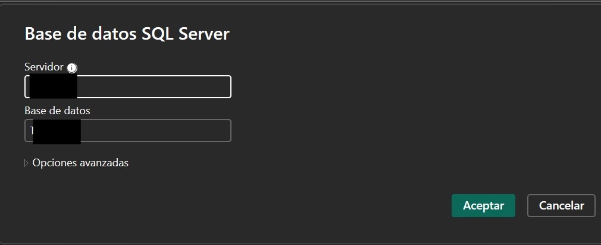
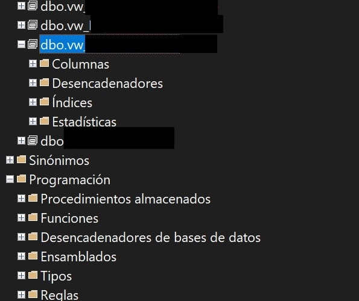
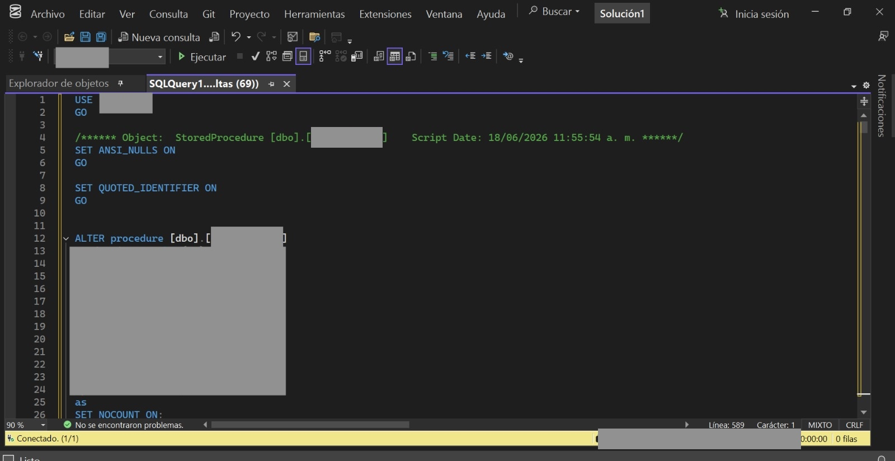
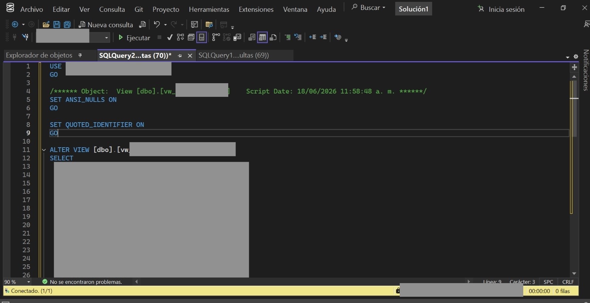
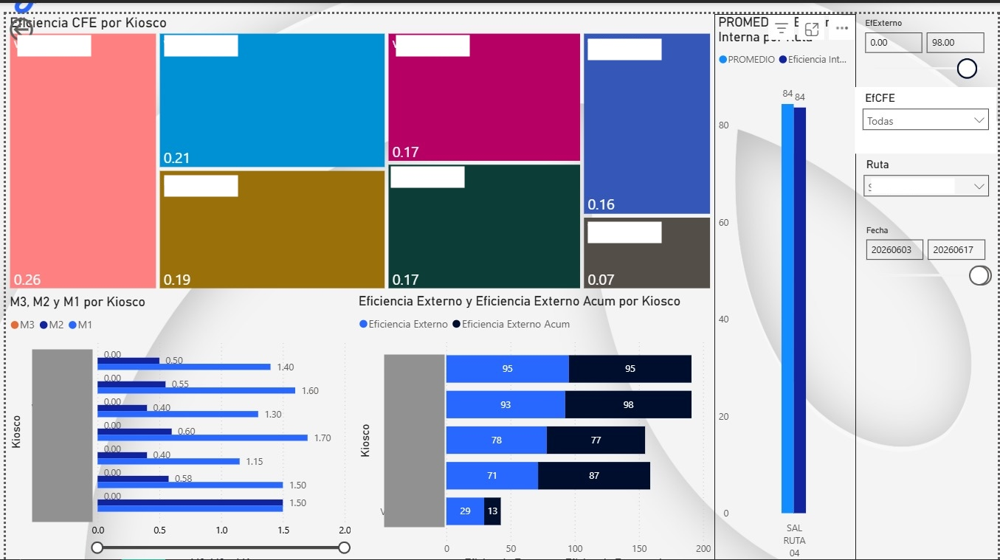

# Dashboard de Eficiencia Operativa y Logística en Puntos de Venta (Power BI & SQL Server) 📊
Este proyecto consiste en el desarrollo de una solución integral de Inteligencia de Negocios (BI) para analizar y medir la **eficiencia operativa, la gestión de labor y el cumplimiento de rutas** en una red de quioscos y almacenes de distribución. 

La solución abarca desde la extracción y transformación de datos en la base de datos relacional hasta la visualización interactiva de indicadores clave (KPIs).
*Arquitectura y Tecnologías Utilizadas* **Base de Datos:** SQL Server (Transact-SQL)* **Capa de Datos y Lógica:** Vistas optimizadas y Procedimientos Almacenados (Stored Procedures)* **Visualización:** Power BI Desktop* **Modelado de Datos:** Lenguaje DAX y Power Query
 *Backend: Optimización en SQL Server*
Para alimentar el reporte de manera eficiente sin penalizar el rendimiento del servidor de producción, se implementó una arquitectura basada en dos componentes principales:

1. **Procedimientos Almacenados (`Stored Procedures`):** Diseñados con parámetros dinámicos (filtros de fechas, empresas, plazas y rutas) para segmentar la información transaccional de manera flexible antes de procesarla.
2. **Vistas (`Views`):** Se crearon vistas personalizadas de consumo exclusivo para Power BI. Esto desacopla el reporte de la estructura interna de las tablas y centraliza la lógica de negocio (como las fechas de lectura decimales y catálogos de componentes).
Frontend: Dashboard Interactivo en Power BI
El tablero visual está diseñado para la toma de decisiones gerenciales y operativas, permitiendo filtrar la información por **Rutas, Fechas y Rangos de Eficiencia**.
*Componentes y KPIs Clave del Reporte:* **Análisis de Eficiencia por Quiosco (Treemap):** Distribución visual que identifica rápidamente qué puntos de venta están absorbiendo la mayor cantidad de labor o incidencias.* **Métricas M1, M2 y M3 por Punto de Venta (Gráfico de Barras):** Desglose detallado de los subindicadores operativos para evaluar el desempeño individual de cada unidad.* **Eficiencia Externa vs. Acumulada:** Comparativo porcentual por quiosco para medir el cumplimiento de metas internas frente al entorno operativo externo.* **Filtros Avanzados (Slicers):** Segmentación por períodos de tiempo específicos y códigos de rutas logísticas.
Cómo Ejecutar el Proyecto1. **Base de Datos:** Ejecutar los scripts de las vistas y procedimientos almacenados en la base de datos SQL Server correspondiente.2. **Conexión:** Configurar las credenciales de origen de datos en Power BI apuntando al servidor y base de datos locales o de desarrollo.
3. **Actualización:** El archivo `.pbix` consumirá los datos transformados de la vista de forma automática al presionar "Actualizar".

**Conexión**

**Estructura de la vista en SQL Server Managment Studio**

 

 

**Vista del Dasboard**

 

